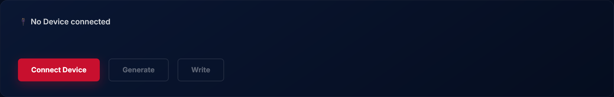
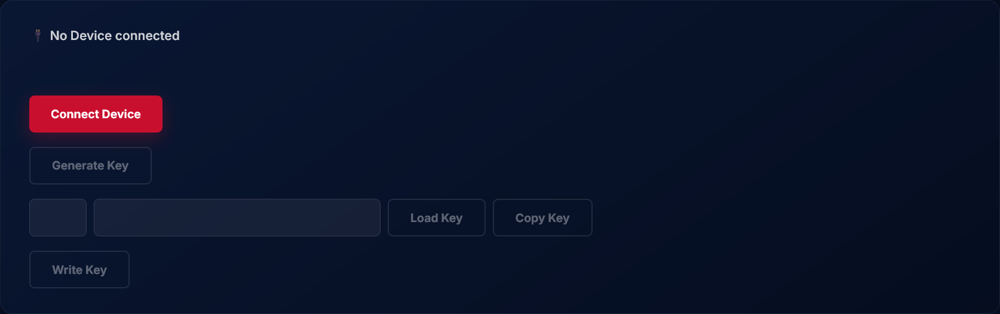

# PitchCom Device Rekey Helper
A JavaScript bookmarklet that assists in rekeying PitchCom receivers (PitchBands, PitchLogs, PitchCaps) and transmitters (PitchRemotes) using [PitchCom's Rekey Your Device web tool](https://support.pitchcom.com/pitchkey.html).

> [!IMPORTANT]
> This is an independent tool that is **not affiliated with or endorsed by PitchCom. Use at your own risk.**

## What this does
PitchCom's website does not allow users to view, save, export, or import generated encryption keys. These keys are permanently lost once the site's browser tab is closed. To add or replace a device, a new key must be generated, forcing teams to manually rekey and retest all of their units, not just the newly added one(s).



This bookmarklet adds functionality directly into the original PitchCom interface that allows users to:
- View full encryption keys, not just KeyIDs.
- Copy/export generated keys to the clipboard so that they can be saved and reused later.
- Paste/import keys back into the website, making it possible to add new devices without modifying existing ones.



## Installation
It is recommended to use [Google Chrome](https://www.google.com/chrome/) for this. Device connection relies on the WebHID API, which is only available in Chromium-based browsers. This will not work in Firefox or Safari.

To install this bookmarklet, copy the code below. Create a new bookmark, paste the code into the bookmark's URL field, and then save it.
```
javascript:(function(){function%20addNewLine(e){const%20t=document.createElement("div");return%20t.className="d-flex%20gap-2%20flex-wrap",t.style.paddingTop="1rem",e.insertAdjacentElement("afterend",t),t}const%20shortKeyDisplay=document.getElementById("eKey"),generateButton=document.getElementById("bKeyGenerate"),writeButton=document.getElementById("bKeyWrite"),line1=shortKeyDisplay.parentElement;generateButton.classList.remove("ms-2"),writeButton.classList.remove("ms-2");const%20line2=addNewLine(line1),line3=addNewLine(line2),line4=addNewLine(line3);line2.append(generateButton),generateButton.textContent="Generate%20Key",line3.append(shortKeyDisplay),shortKeyDisplay.removeAttribute("type"),shortKeyDisplay.style.maxWidth="64px";const%20fullKeyDisplay=document.createElement("input");function%20createButton(e,t){const%20a=document.createElement("button");return%20a.id=e,a.className="btn%20btn-primary",a.textContent=t,a.disabled=!0,a}fullKeyDisplay.id="fullKey",fullKeyDisplay.className="form-control",fullKeyDisplay.style.maxWidth="320px";const%20loadButton=createButton("bKeyLoad","Load%20Key"),copyButton=createButton("bKeyCopy","Copy%20Key");line3.append(fullKeyDisplay,loadButton,copyButton),line4.append(writeButton),writeButton.textContent="Write%20Key";const%20output=document.getElementById("output");function%20addMessage(e,t){const%20a=document.createElement("span");a.textContent=e,a.style.color=t,output.append(a,document.createElement("br"))}let%20fullKey,fullKeyHex;function%20generateKey(){fullKey=handler.key,fullKeyHex=Array.from(handler.key).map(e=>e.toString(16).padStart(2,"0")).join("").toUpperCase(),fullKeyDisplay.value=fullKeyHex,addMessage(`Key%20generated,%20KeyID:%20${shortKeyDisplay.value}`,"green"),loadButton.disabled=!1,copyButton.disabled=!1}function%20isValidKey(){const%20e=fullKeyDisplay.value.trim();return!!/^[0-9a-fA-F]{16}$/.test(e)}function%20toggleButtons(){loadButton.disabled=""==fullKeyDisplay.value.trim(),copyButton.disabled=!isValidKey()}function%20loadKey(){isValidKey()?(fullKeyDisplay.value=fullKeyDisplay.value.toUpperCase(),fullKeyHex=fullKeyDisplay.value,fullKey=handler.key=new%20Uint8Array(fullKeyHex.match(/.{1,2}/g).map(e=>parseInt(e,16))),keyID=handler.crc8Java(fullKey),shortKeyDisplay.value=keyID.toString(16).padStart(2,"0").toUpperCase(),copyButton.disabled=!1,addMessage(`Key%20loaded,%20KeyID:%20${shortKeyDisplay.value}`,"green")):addMessage("Key%20invalid,%20load%20unsuccessful.%20Double%20check%20that%20the%20key%20is%20correct,%20or%20generate%20a%20new%20one.","red")}async%20function%20copyKey(){if(isValidKey())try{await%20navigator.clipboard.writeText(fullKeyDisplay.value.trim().toUpperCase()),addMessage(`Key%20copied%20to%20clipboard,%20KeyID:%20${shortKeyDisplay.value}`,"green")}catch{addMessage(`Key%20failed%20to%20copy,%20KeyID:%20${shortKeyDisplay.value}`,"red")}else%20addMessage("Key%20invalid,%20copy%20unsuccessful.%20Double%20check%20that%20the%20key%20is%20correct,%20or%20generate%20a%20new%20one.","red")}generateButton.addEventListener("click",generateKey),fullKeyDisplay.addEventListener("input",toggleButtons),loadButton.addEventListener("click",loadKey),copyButton.addEventListener("click",copyKey);})();
```

To activate the bookmarklet, click on the bookmark while on the Rekey Your Device page.

## Usage
### First Time
1. Follow the original instructions on the page regarding connecting devices, generating a key, and writing that same key to each device.
2. Before closing the tool, click `Copy Key`, and save this value into a password manager (and/or write it down).

### Future Additions
1. Paste the previously saved key value back into the key field, and click `Load Key`.
2. Use the `Connect Device` and `Write Key` buttons to key devices as usual.

## Other
- Tested on PitchRemote, PitchBand, PitchCap, and PitchLog devices running firmware version 5.17.
- JavaScript was minified using [Code Beautify](https://codebeautify.org/minify-js).

> [!CAUTION]
> If a staff member who keyed PitchCom devices leaves, all devices should be reprogrammed with a new key.